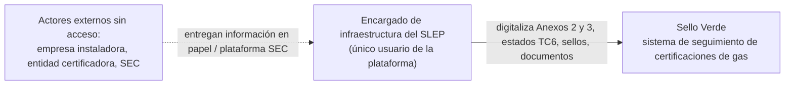
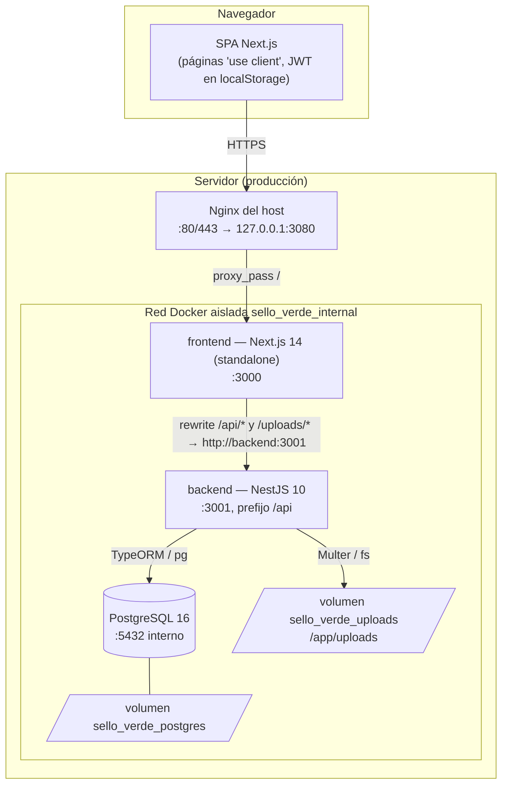
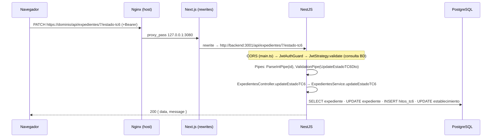
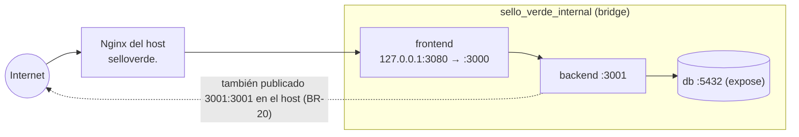

# 01 — Arquitectura

> **Alcance:** contexto y contenedores (C4 niveles 1 y 2), stack con versiones, patrón modular del backend, flujo de una request y topología de despliegue dev vs prod. **No cubre:** detalle de datos (→ `02`), endpoints (→ `03`), procedimientos operativos (→ `07`).
> **Fuentes:** `backend/package.json`, `frontend/package.json`, ambos `package-lock.json`, `backend/src/main.ts`, `backend/src/app.module.ts`, `frontend/next.config.js`, `docker-compose.yml`, `docker-compose.prod.yml`, `backend/Dockerfile*`, `frontend/Dockerfile*`, `nginx/sello-verde.conf`, `AGENTS.md`.
> **Verificado contra:** commit `c66929e` (+ cambios locales sin commitear) · 2026-10-09
> **Lectores:** desarrollador nuevo; agente que necesita saber dónde vive cada responsabilidad.

## 1. Vista C4 nivel 1 — contexto



**Prosa.** El sistema lo usa una sola persona (el encargado del proceso en el SLEP), que actúa como digitador de la información que producen terceros: la empresa instaladora (levantamiento y proyecto TC6), la entidad certificadora (inspección y sello) y la SEC (aprobación del TC6). Esos terceros **no** acceden a la plataforma ni hay integración técnica con la SEC (`flujo_software.md`, `contexto_proyecto.md`). El sistema registra, controla plazos (2 años para sello verde, 90 días para regularizar) y centraliza el expediente documental.

> ⚠️ NO VERIFICADO: el repo menciona integraciones futuras con Google (variables `GOOGLE_*`, `GMAIL_API_KEY` comentadas en `.env`); no hay código que las use.

## 2. Vista C4 nivel 2 — contenedores



**Prosa.** En producción el navegador solo habla con el dominio público: Nginx (instalado en el host, no en Docker) envía todo al contenedor Next.js, y Next.js actúa además como **proxy de la API**: sus `rewrites` (`frontend/next.config.js`) reenvían `/api/*` y `/uploads/*` al backend usando la URL interna `NEXT_INTERNAL_API_URL=http://backend:3001`. El backend guarda archivos subidos en un volumen y datos en PostgreSQL. Hay tres contenedores (`db`, `backend`, `frontend`); no hay cola, caché, ni servicios externos. El único proceso en segundo plano es un cron dentro del propio backend (`@nestjs/schedule`).

## 3. Stack con versiones

Versiones "rango" = lo declarado en `package.json`; "resuelta" = lo que fija `package-lock.json`.

| Capa | Tecnología | Rango | Resuelta | Origen |
|---|---|---|---|---|
| Runtime | Node.js | — | imagen `node:20-slim` | `backend/Dockerfile*`, `frontend/Dockerfile*` |
| Backend | NestJS (`common`, `core`, `platform-express`) | `^10.0.0` | 10.4.22 | `backend/package.json` |
| Backend | `@nestjs/typeorm` / `typeorm` | `^10.0.2` / `^0.3.20` | 10.0.2 / 0.3.31 | idem |
| Backend | `pg` | `^8.11.3` | 8.22.0 | idem |
| Backend | `@nestjs/jwt` / `@nestjs/passport` / `passport-jwt` | `^10.2.0` / `^10.0.3` / `^4.0.1` | 10.2.0 / 10.0.3 / 4.0.1 | idem |
| Backend | `bcrypt` | `^5.1.1` | 5.1.1 | idem |
| Backend | `class-validator` / `class-transformer` | `^0.14.1` / `^0.5.1` | 0.14.4 / 0.5.1 | idem |
| Backend | `@nestjs/schedule` / `@nestjs/serve-static` | `^4.0.0` / `^4.0.2` | 4.1.2 / 4.0.2 | idem |
| Backend | `multer` | `^2.1.1` | 2.2.0 | idem |
| Backend | TypeScript | `^5.1.3` | 5.9.3 | idem |
| Frontend | Next.js (App Router) | `14.2.29` (fija) | 14.2.29 | `frontend/package.json` |
| Frontend | React / React DOM | `^18.3.1` | 18.3.1 | idem |
| Frontend | TypeScript | `^5.5.2` | 5.9.3 | idem |
| Datos | PostgreSQL | — | imagen `postgres:16-alpine` | `docker-compose*.yml` |
| Infra | Docker Compose | atributo `version: '3.8'` (obsoleto en Compose v2) | — | `docker-compose*.yml` |
| Infra | Nginx (host) | — | — | `nginx/sello-verde.conf` |

> ⚠️ NO VERIFICADO: versión de Nginx y del Docker del servidor (no están en el repo). El lockfile del backend resuelve `jest@30.4.2` junto a `ts-jest@29.4.11`; no se comprobó la compatibilidad de esas versiones entre sí.

El frontend **no usa** librería de UI, de estado ni de fetching: todo es React + un wrapper de `fetch` propio (`frontend/src/lib/api.ts`) y CSS propio (`app/globals.css`, tokens según `AGENTS.md`).

## 4. Patrón modular del backend

Cada dominio es una carpeta en `backend/src/<dominio>/` registrada como módulo NestJS en `app.module.ts`. Estructura real (módulo `instalaciones`, el más simple, como referencia):

```
instalaciones/
  instalaciones.module.ts      ← declara imports (forFeature), controllers, providers, exports
  instalaciones.controller.ts  ← rutas HTTP, @UseGuards(JwtAuthGuard), ParseIntPipe
  instalaciones.service.ts     ← lógica + acceso a datos (@InjectRepository)
  entities/instalacion.entity.ts
  dto/create-instalacion.dto.ts
```

Variantes presentes: varios controllers por módulo (`establecimientos` tiene `EstablecimientosController` y `LocalesController`; `documentos` tiene `DocumentosController` y `DocumentosItemController`), controllers sin prefijo (`@Controller()`) que definen rutas anidadas (`instalaciones`, `certificaciones`), y entidades varias por módulo.

### Responsabilidad por capa y lo que no debe cruzarse

| Capa | Debe | No debe | Consecuencia de violarlo |
|---|---|---|---|
| **Controller** | Mapear ruta/verbo → método de servicio; declarar guard y pipes (`ParseIntPipe`); recibir el DTO | Contener lógica de negocio, tocar repositorios o `Request` crudo más de lo necesario | Lógica duplicada entre endpoints; reglas fuera de los servicios (que otros servicios sí reutilizan) |
| **Service** | Reglas de negocio, orquestación, acceso a **sus** repositorios, producir el envoltorio `{ data, message }` | Inyectar repositorios de dominios ajenos; conocer detalles de HTTP salvo las excepciones Nest | Cascadas y estados inconsistentes; dependencias circulares; incumple `AGENTS.md` (§ "Responsabilidad de dominio en cascadas") |
| **Entity** | Describir tablas, relaciones, `@DeleteDateColumn` | Tener lógica; importar servicios | El esquema se genera desde ellas (`synchronize`), así que un cambio de clase es un cambio de BD |
| **DTO** | Validación con `class-validator` | Ser `Partial<...>` como tipo del `@Body` (se pierde la validación, BR-01) | Cuerpos sin validar y asignación masiva |
| **Module** | Exportar el *servicio* que otros dominios necesiten | Exportar solo para inyectar repositorios ajenos | Acoplamiento de dominios |

La regla de `AGENTS.md` es explícita: *cada servicio es el único dueño de los repositorios de su dominio; las cascadas se hacen llamando a métodos del servicio correcto* (p. ej. `ExpedientesService.removeByEstablecimiento` invocado desde `EstablecimientosService.remove`, ya conforme a la regla).

> 🔸 BRECHA [BR-15]: el código actual la incumple en varios puntos: `ExpedientesService` inyecta `Repository<Establecimiento>` y `Repository<Alerta>`; `CertificacionesService` inyecta repositorios de `Expediente`, `Establecimiento` y `Alerta`; `DocumentosService` inyecta `Repository<Expediente>`; `DashboardService` inyecta `Repository<Establecimiento>` y `Repository<Alerta>`; y los módulos listan entidades ajenas en `forFeature` para permitirlo. Los servicios también construyen la forma HTTP de la respuesta (`{ data, message }`).

**Dependencias entre módulos (única que hay):** `EstablecimientosModule` importa `ExpedientesModule` y usa `ExpedientesService`. Los demás dominios se comunican a través de repositorios compartidos, no de servicios.

## 5. Flujo de una request de punta a punta

Ejemplo: `PATCH /api/expedientes/7/estado-tc6` en producción.



**Prosa — orden real de ejecución en NestJS:** middleware/CORS → **guards** (`JwtAuthGuard`) → **interceptors** (en subidas, `FileInterceptor` de Multer) → **pipes** (`ParseIntPipe`, `ValidationPipe` global) → handler. Que los interceptors corran *antes* que los pipes importa en la subida de documentos: Multer decide el directorio de destino con el parámetro de ruta **sin validar** (BR-07). No hay filtros de excepciones, interceptores ni middleware globales propios; los errores salen con el formato por defecto de Nest (`03-api-contract.md` §2.4).

El servicio hace varias escrituras **sin transacción** (no hay `transaction`/`QueryRunner` en el código): ante un fallo intermedio puede quedar un estado a medias (p. ej. `estado_tc6` cambiado pero sin hito).

> 🔸 BRECHA [BR-18]: las operaciones multi-escritura (`ExpedientesService.updateEstadoTC6`, `CertificacionesService.create/update`, cascada de borrado) no son atómicas.

En **desarrollo** el camino es más corto: el navegador llama **directo** al backend (`http://localhost:3001/api`, CORS con `CORS_ORIGIN=http://localhost:3000`) porque la URL base se hornea en el bundle (`frontend/src/lib/constants.ts`).

## 6. Topología de despliegue

### 6.1 Desarrollo (`docker-compose.yml`)

- Servicios: `db` (puerto de host `DB_PORT`, por defecto 5432), `backend` (3001) y `frontend` (3000) en la red `sello-verde-network`.
- `NODE_ENV: development` en el backend ⇒ activa el seed de datos de ejemplo (`02-modelo-datos.md` §9) y el logging SQL.
- Volúmenes: `postgres_data`, `backend_uploads`, y montajes de `./backend/src` y `./frontend/src` dentro de los contenedores.
- Los `Dockerfile` de desarrollo **compilan y ejecutan el build** (`node dist/main`, `node server.js`), no un modo watch. ⚠️ NO VERIFICADO: por eso los montajes de `src` probablemente no producen recarga en caliente sin reconstruir la imagen (el plan histórico prometía hot-reload).
- El backend usa valores por defecto sensibles en el compose (BR-03).

> 🔸 BRECHA [BR-27]: `docker-compose.yml` define `NEXT_PUBLIC_API_URL` **con** sufijo `/api`, mientras `frontend/src/lib/constants.ts` agrega `/api` por su cuenta y `frontend/.env.example` indica "WITHOUT /api suffix". La variable se lee en tiempo de *build* para el bundle del cliente y el `Dockerfile` de desarrollo no recibe `ARG`; ⚠️ NO VERIFICADO qué URL termina usando el navegador en este modo (el fallback de `constants.ts` es `http://localhost:3001/api`).

### 6.2 Producción (`docker-compose.prod.yml`)



- Imágenes construidas con `Dockerfile.prod` (multi-stage). El frontend usa `output: 'standalone'` y corre como usuario no root (`nextjs`); el backend **corre como root** (no define `USER`).
- Variables sin defaults (`${VAR}`); `NEXT_PUBLIC_API_URL` entra como **build arg** (se hornea al construir: cambiarlo exige reconstruir la imagen del frontend).
- `restart: always`; healthchecks en db, backend y frontend; el frontend espera al backend `healthy` y este a la base `healthy`.
- Volúmenes nombrados `sello_verde_postgres` y `sello_verde_uploads`.
- Nginx (`nginx/sello-verde.conf`) escucha en 80, `client_max_body_size 55m`, reenvía al frontend; el SSL lo agrega Certbot manualmente (instrucciones en el propio archivo). El dominio está definido en ese archivo.
- El backend en producción conecta a la BD con `DATABASE_*` y arranca con `synchronize: true` (BR-16).

## 7. Qué hay y qué falta (resumen para el lector)

- Hay: monolito modular, JWT propio, cron interno, filesystem para archivos, Next.js como SPA + proxy.
- No hay: tests, migraciones, versionado de API, OpenAPI, autorización por roles, rate limiting, observabilidad más allá de `console.log`, backups automatizados. Cada ausencia está registrada como brecha en `00-README.md` (índice de BR-xx).
