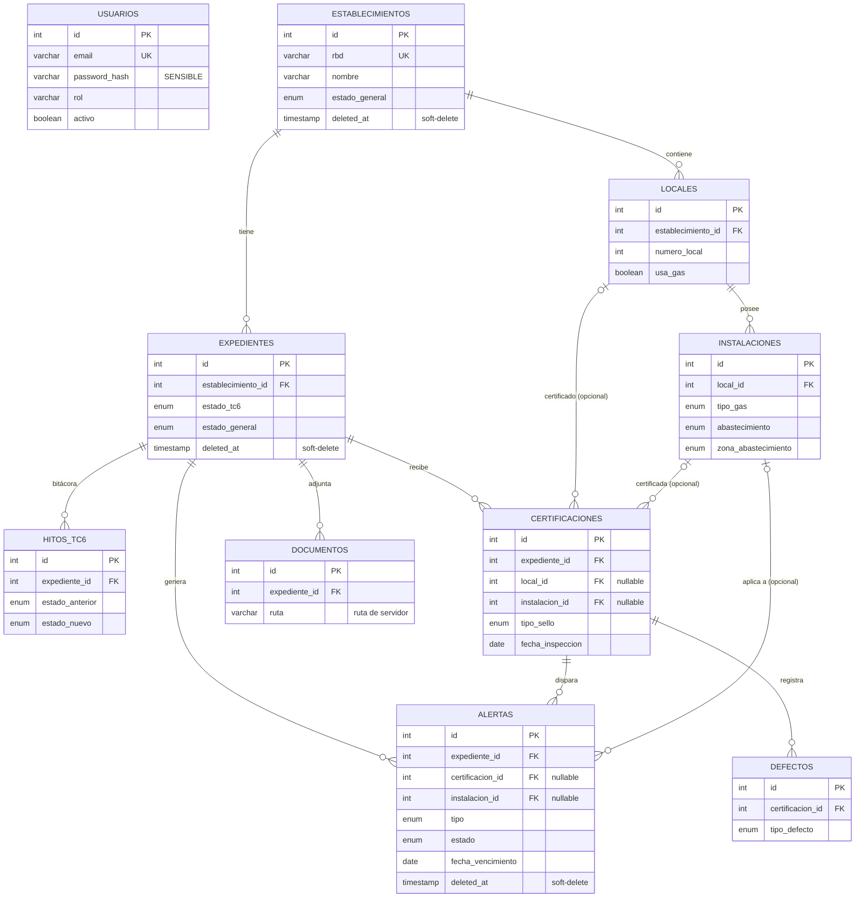

# 02 — Modelo de datos

> **Alcance:** esquema relacional real (PostgreSQL vía TypeORM), claves, índices, cardinalidades, enums, estrategia de borrado, campos sensibles y datos de seed. **No cubre:** contrato HTTP (→ `03-api-contract.md`), reglas de acceso (→ `04-seguridad-y-acceso.md`).
> **Fuentes:** `backend/src/**/entities/*.entity.ts`, `backend/src/common/enums/*.enum.ts`, `backend/src/app.module.ts`, `backend/src/database/seed/seed.service.ts`, `AGENTS.md`.
> **Verificado contra:** commit `c66929e` (+ cambios locales sin commitear, ver `00-README.md`) · 2026-10-09
> **Lectores:** desarrollador nuevo que debe explicar el modelo; agente de IA que va a tocar entidades, DTOs o borrados.

## 1. Cómo se materializa el esquema

El esquema **no está escrito en SQL ni en migraciones**: lo genera TypeORM a partir de las clases `@Entity` en cada arranque, porque `TypeOrmModule.forRoot` usa `synchronize: true` (`app.module.ts`, bloque `TypeOrmModule.forRoot`, comentario "MVP only — use migrations in production"). Consecuencias directas:

- No existe carpeta de migraciones en `backend/src` ni script `typeorm migration:*` en `backend/package.json`.
- Una entidad que **no esté en el array `entities` de `app.module.ts`** no genera tabla, aunque tenga `@Entity` y su módulo la use con `forFeature`. El array es explícito (sin glob): hoy lista las 10 entidades.
- `synchronize: true` también altera/elimina columnas cuando cambia la clase. Ver riesgo en `07-operacion.md` y `[BR-16]` en `00-README.md`.
- No hay ningún `@Index` en el código (verificado por búsqueda). Los únicos índices son los de PK y `unique`.

> 🔸 BRECHA [BR-16]: producción corre con `synchronize: true` y sin migraciones, aunque `DEPLOYMENT_SOP.md` (sección 4) exige aplicar migraciones TypeORM antes de arrancar.

## 2. Diagrama entidad-relación

**Cómo leerlo.** Hay dos "ramas" desde `establecimientos`: la **rama física** (`locales` → `instalaciones`, es el Anexo 2 SEC: qué hay en terreno) y la **rama de proceso** (`expedientes` → todo lo demás: hitos, certificaciones, defectos, alertas, documentos). `expedientes` es la raíz de agregado del proceso de certificación: casi todo lo que cambia en el tiempo cuelga de él. `certificaciones` y `alertas` hacen de puente entre ambas ramas porque pueden apuntar (opcionalmente) a un `local` o una `instalacion` concreta: eso permite que cada instalación tenga su propio ciclo de sello y alerta dentro de un mismo expediente. `usuarios` no se relaciona con ninguna tabla (no hay "creado por").

## 3. Esquema por tabla

Convenciones comunes (todas las entidades): `id` serial (`@PrimaryGeneratedColumn`), nombres de columna en `snake_case`, `created_at`/`updated_at` automáticos salvo donde se indica. `@Column()` sin `nullable` ⇒ `NOT NULL`. Los `string` quedan como `varchar` y los `number` como `integer` (salvo los `decimal` indicados).

### 3.1 `usuarios` — `auth/entities/usuario.entity.ts:Usuario`
| Columna | Tipo | Restricciones |
|---|---|---|
| `id` | int | PK |
| `nombre` | varchar | NOT NULL |
| `email` | varchar | NOT NULL, **UNIQUE** |
| `password_hash` | varchar | NOT NULL — **sensible** |
| `rol` | varchar | NOT NULL, default `'admin'` (texto libre, no enum) |
| `activo` | boolean | default `true` |
| `created_at`, `updated_at` | timestamp | auto |

### 3.2 `establecimientos` — `establecimientos/entities/establecimiento.entity.ts:Establecimiento`
| Columna | Tipo | Restricciones |
|---|---|---|
| `id` | int | PK |
| `rbd` | varchar | NOT NULL, **UNIQUE** (es `string`, no numérico) |
| `nombre` | varchar | NOT NULL |
| `direccion`, `nombre_propietario`, `telefono`, `email`, `comuna`, `region` | varchar | NULL |
| `estado_general` | enum `EstadoGeneral` | NOT NULL, default `sin_gestion` |
| `cantidad_locales` | int | NULL (dato declarado, **no** se recalcula desde `locales`) |
| `observaciones` | text | NULL |
| `created_at`, `updated_at` | timestamp | auto |
| `deleted_at` | timestamp | `@DeleteDateColumn` (soft-delete) |

Relaciones ORM: `locales` (OneToMany, `cascade: true`), `expedientes` (OneToMany).

### 3.3 `locales` — `establecimientos/entities/local.entity.ts:Local`
| Columna | Tipo | Restricciones |
|---|---|---|
| `id` | int | PK |
| `establecimiento_id` | int | NOT NULL, FK → `establecimientos.id` **ON DELETE CASCADE** |
| `numero_local` | int | NOT NULL (correlativo; **sin unicidad** por establecimiento) |
| `nombre`, `direccion` | varchar | NULL |
| `usa_gas` | boolean | default `true` |
| `observaciones` | text | NULL |
| `created_at`, `updated_at` | timestamp | auto. **No tiene `deleted_at`.** |

Relación ORM: `instalaciones` (OneToMany, `cascade: true`).

### 3.4 `instalaciones` — `instalaciones/entities/instalacion.entity.ts:Instalacion`
| Columna | Tipo | Restricciones |
|---|---|---|
| `id` | int | PK |
| `local_id` | int | NOT NULL, FK → `locales.id` **ON DELETE CASCADE** |
| `tipo_gas` | enum `TipoGas` | NULL |
| `abastecimiento` | enum `Abastecimiento` | NULL |
| `zona_abastecimiento` | enum `ZonaAbastecimiento` | NULL |
| `referencia`, `artefacto_cilindro` | varchar | NULL |
| `observaciones` | text | NULL |
| `created_at`, `updated_at` | timestamp | auto. **No tiene `deleted_at`.** |

### 3.5 `expedientes` — `expedientes/entities/expediente.entity.ts:Expediente`
| Columna | Tipo | Restricciones |
|---|---|---|
| `id` | int | PK |
| `establecimiento_id` | int | NOT NULL, FK → `establecimientos.id` (sin ON DELETE ⇒ NO ACTION) |
| `empresa_instaladora`, `rut_empresa`, `contacto_empresa`, `telefono_empresa`, `email_empresa` | varchar | NULL — datos de contacto de terceros (ver §7) |
| `estado_tc6` | enum `EstadoTC6` | NOT NULL, default `sin_iniciar` |
| `estado_general` | enum `EstadoGeneral` | NOT NULL, default `sin_gestion` |
| `monto_presupuesto`, `monto_ejecutado` | decimal(12,2) | NULL |
| `numero_licitacion` | varchar | NULL |
| `fecha_inicio`, `fecha_fin_estimada` | date | NULL |
| `observaciones` | text | NULL |
| `created_at`, `updated_at`, `deleted_at` | timestamp | auto + soft-delete |

Relaciones ORM: `certificaciones`, `documentos`, `hitos`, `alertas` (todas OneToMany, sin `cascade`).

### 3.6 `hitos_tc6` — `expedientes/entities/hito-tc6.entity.ts:HitoTC6`
Bitácora inmutable de cambios de `estado_tc6`.
| Columna | Tipo | Restricciones |
|---|---|---|
| `id` | int | PK |
| `expediente_id` | int | NOT NULL, FK → `expedientes.id` **ON DELETE CASCADE** |
| `estado_anterior` | enum `EstadoTC6` | NULL (NULL en el hito inicial) |
| `estado_nuevo` | enum `EstadoTC6` | NOT NULL |
| `observaciones` | text | NULL |
| `fecha` | timestamp | auto (`@CreateDateColumn`) |

### 3.7 `certificaciones` — `certificaciones/entities/certificacion.entity.ts:Certificacion`
| Columna | Tipo | Restricciones |
|---|---|---|
| `id` | int | PK |
| `expediente_id` | int | NOT NULL, FK → `expedientes.id` (NO ACTION) |
| `local_id` | int | NULL, FK → `locales.id` (NO ACTION) — local inspeccionado |
| `instalacion_id` | int | NULL, FK → `instalaciones.id` (NO ACTION) — instalación inspeccionada |
| `tipo_sello` | enum `TipoSello` | NULL |
| `nombre_inspector`, `entidad_certificadora`, `rut_inspector` | varchar | NULL |
| `fecha_inspeccion` | date | NULL |
| `numero_certificado`, `url_certificado` | varchar | NULL |
| `observaciones` | text | NULL |
| `created_at`, `updated_at` | timestamp | auto. **No tiene `deleted_at`.** |

Relaciones ORM: `defectos` (OneToMany, `cascade: true`), `alertas` (OneToMany).

### 3.8 `defectos` — `certificaciones/entities/defecto.entity.ts:Defecto`
| Columna | Tipo | Restricciones |
|---|---|---|
| `id` | int | PK |
| `certificacion_id` | int | NOT NULL, FK → `certificaciones.id` **ON DELETE CASCADE** |
| `tipo_defecto` | enum `TipoDefecto` | NOT NULL |
| `instalacion_afectada`, `descripcion` | text | NULL |
| `created_at` | timestamp | auto |

### 3.9 `alertas` — `alertas/entities/alerta.entity.ts:Alerta`
| Columna | Tipo | Restricciones |
|---|---|---|
| `id` | int | PK |
| `expediente_id` | int | NOT NULL, FK → `expedientes.id` (NO ACTION) |
| `certificacion_id` | int | NULL, FK → `certificaciones.id` |
| `instalacion_id` | int | NULL, FK → `instalaciones.id` — "lifecycle por instalación" |
| `tipo` | enum `TipoAlerta` | NOT NULL |
| `estado` | enum `EstadoAlerta` | NOT NULL, default `activa` |
| `fecha_vencimiento` | date | NOT NULL |
| `mensaje` | text | NULL (texto generado por el servicio, incluye nombre del establecimiento) |
| `fecha_notificacion` | timestamp | NULL |
| `created_at`, `updated_at`, `deleted_at` | timestamp | auto + soft-delete |

### 3.10 `documentos` — `documentos/entities/documento.entity.ts:Documento`
| Columna | Tipo | Restricciones |
|---|---|---|
| `id` | int | PK |
| `expediente_id` | int | NOT NULL, FK → `expedientes.id` |
| `nombre_original` | varchar | NOT NULL (nombre visible; editable) |
| `nombre_archivo` | varchar | NOT NULL (nombre en disco) |
| `ruta` | varchar | NOT NULL — **ruta de filesystem del servidor** |
| `tipo_mime` | varchar | NULL |
| `tamano_bytes` | int | NULL |
| `descripcion` | varchar | NULL |
| `created_at`, `updated_at` | timestamp | auto. **No tiene `deleted_at`.** |

## 4. Claves, índices y cardinalidades

- **Únicos:** `establecimientos.rbd`, `usuarios.email`. Nada más (no hay unicidad de `locales(establecimiento_id, numero_local)`).
- **Índices sobre FKs:** ninguno declarado; PostgreSQL no indexa FKs automáticamente. Ver deuda en `05-guia-de-extension.md`.
- **Cardinalidades:** 1 `establecimiento` → N `locales` → N `instalaciones`; 1 `establecimiento` → N `expedientes` **en el esquema**, pero el servicio fuerza **a lo más un expediente vigente por establecimiento** (`ExpedientesService.create`, que rechaza con 400 si `findOne({establecimiento_id})` encuentra uno). `findOne` excluye filas con `deleted_at`, por lo que tras un soft-delete se puede crear otro. Esa regla **no existe en la base** (no hay UNIQUE parcial): solo la garantiza el servicio.
- **"Expediente activo":** el código define el activo como el de **mayor `id`** (`EstablecimientosService.findAll/findOne`), no un campo.

## 5. Razonamiento de diseño (por qué así)

- **Relacional y no documental.** El dominio son formularios SEC con jerarquía fija (establecimiento → locales → instalaciones; expediente → certificaciones → defectos) y se consulta por estado y por fechas; el plan histórico ya partía de un ERD relacional (`Documentacion/historico/implementation_plan_iter1.md`, §1.2). La alternativa documental no está discutida en ningún archivo del repo.
  > ⚠️ NO VERIFICADO: el motivo explícito de elegir PostgreSQL frente a otras bases no está registrado; `AGENTS.md` lo impone como parte del stack. Confirmar con el equipo.
- **Locales/instalaciones separados del expediente.** El Anexo 2 describe la planta física, que existe independientemente de cuántas veces se certifique; por eso `locales` cuelga del establecimiento y no del expediente (`flujo_software.md` §2, `requistos_proyecto.md` Formulario 1).
- **Certificación apunta a `local`/`instalacion` opcionales.** Permite certificar y alertar por instalación; las columnas son NULL para mantener compatibilidad con certificaciones "generales" (el código llama "legacy" a las alertas sin `instalacion_id`: `CertificacionesService.create`, rama `IsNull()`).
- **`estado_general` está duplicado** en `establecimientos` y `expedientes`. El de `establecimientos` es una **copia denormalizada** que los servicios sincronizan a mano (`ExpedientesService.create/update/updateEstadoTC6/revertEstadoTC6`, `CertificacionesService.create/update`). Se hizo así para que el dashboard cuente por establecimiento con un `count()` simple (`DashboardService.getResumen`). Riesgo: `PUT /establecimientos/:id` también permite escribirlo y diverge.
  > 🔸 BRECHA [BR-24]: el valor `en_regularizacion` existe en el enum y se cuenta en el dashboard, pero ningún servicio lo asigna nunca (búsqueda en `backend/src`: solo aparece en `dashboard.service.ts`).
- **Hitos TC6 como tabla aparte** (no un array JSON) porque son un historial append-only que se ordena por `fecha` (`ExpedientesService.findOne`, `order: { hitos: { fecha: 'ASC' } }`).
- **Alertas materializadas** (tabla) en vez de calculadas al vuelo: permiten cambiar de estado (`activa → notificada → resuelta/vencida`), eliminarse y filtrarse; las reglas de generación están en `CertificacionesService` y las de transición en `AlertasService` (detalle en `05-guia-de-extension.md`).
- **`cascade: true` en ORM** (`Establecimiento.locales`, `Local.instalaciones`, `Certificacion.defectos`) solo afecta a `save()`: permite guardar el árbol de una vez. No implica borrado en cascada.

## 6. Estrategia de borrado

| Entidad | Tiene `@DeleteDateColumn` | Operación de borrado actual |
|---|---|---|
| `Establecimiento` | Sí | `DELETE /establecimientos/:id` → `softDelete` |
| `Expediente` | Sí | Vía `removeByEstablecimiento` → `softDelete`. Vía `DELETE /expedientes/:id` **no se borra** (ver BR-14) |
| `Alerta` | Sí | `DELETE /alertas/:id` (solo si `resuelta`) y cascada → `softDelete` |
| `Local`, `Instalacion`, `Certificacion`, `Defecto`, `Documento`, `HitoTC6`, `Usuario` | **No** | `Instalacion` y `Documento`: borrado físico (`remove`); `Defecto`: `delete` físico al reemplazar la lista; el resto nunca se borra por API |

La cascada de `DELETE /establecimientos/:id` es: `EstablecimientosService.remove` → `ExpedientesService.removeByEstablecimiento` (soft-delete de alertas de sus expedientes, luego de los expedientes) → `softDelete` del establecimiento. **No** toca locales, instalaciones, certificaciones, defectos ni documentos (ni los archivos en disco): quedan huérfanos pero invisibles porque se llega a ellos solo a través de padres soft-deleted.

> 🔸 BRECHA [BR-14]: `AGENTS.md` ("Soft-Delete — Checklist obligatorio") exige `@DeleteDateColumn` en **todas** las entidades de una cascada y `softDelete()` para todas; solo 3 de 10 entidades lo tienen, y `ExpedientesService.remove` (`DELETE /expedientes/:id`) hace `softDelete` solo de las alertas y responde éxito sin borrar el expediente.

> 🔸 BRECHA [BR-21]: `rbd` es `UNIQUE` a nivel de base y el soft-delete conserva la fila; recrear un establecimiento con el mismo RBD tras borrarlo debería fallar por violación de unicidad. ⚠️ NO VERIFICADO en ejecución (se deduce de las definiciones de `Establecimiento.rbd` y `softDelete`).

## 7. Campos sensibles y dónde se filtran

| Dato | Tabla.columna | Por qué es sensible | ¿Se proyecta fuera de las respuestas? |
|---|---|---|---|
| Hash de contraseña | `usuarios.password_hash` | Credencial | **Sí**: `AuthService.login/getMe` devuelven una lista explícita de campos (`id, nombre, email, rol`) y ninguna otra entidad referencia a `Usuario` |
| RUT, contacto y teléfono de empresa instaladora | `expedientes.rut_empresa`, `contacto_empresa`, `telefono_empresa`, `email_empresa` | Datos de terceros | **No**: se devuelven completos en `GET /expedientes`, `GET /expedientes/:id` y dentro de `GET /establecimientos*` (relación `expedientes`) |
| RUT e identidad del inspector | `certificaciones.rut_inspector`, `nombre_inspector` | Dato personal | **No**: se devuelve en endpoints de certificaciones y en `GET /expedientes/:id` |
| Propietario, teléfono, email del establecimiento | `establecimientos.nombre_propietario`, `telefono`, `email` | Dato de contacto | **No** |
| Ruta física del archivo | `documentos.ruta`, `nombre_archivo` | Revela estructura del servidor | **No**: `DocumentosService.toDto` hace `...doc` e incluye `ruta` |
| Montos presupuestarios | `expedientes.monto_presupuesto`, `monto_ejecutado` | Información financiera interna | **No** |

No existe ninguna capa de proyección: las entidades se serializan completas (ver `03-api-contract.md` §Modelo público). Todo lo anterior solo es accesible con JWT válido (`04-seguridad-y-acceso.md`).

## 8. Enums y catálogos (`backend/src/common/enums/`)

| Enum (archivo) | Valores |
|---|---|
| `EstadoGeneral` (`estado-general.enum.ts`) | `sin_gestion`, `en_levantamiento`, `en_proyecto`, `en_certificacion`, `sello_verde`, `sello_rojo`, `sello_amarillo`, `en_regularizacion` |
| `EstadoTC6` (`estado-tc6.enum.ts`) | `sin_iniciar`, `en_elaboracion`, `ingresado_sec`, `observado`, `tc6_aprobado` |
| `TipoSello` (`tipo-sello.enum.ts`) | `verde`, `amarillo`, `rojo` |
| `TipoGas` (`tipo-gas.enum.ts`) | `GLP`, `Gas Natural` |
| `Abastecimiento` (`abastecimiento.enum.ts`) | `GDR`, `Equipo GLP`, `Cilindros 45 kg`, `Cilindros 11-15 kg`, `GRANEL` |
| `ZonaAbastecimiento` (`zona-abastecimiento.enum.ts`) | `Casino`, `Camarines`, `Sala de clases`, `Otros` |
| `TipoAlerta` (`tipo-alerta.enum.ts`) | `vencimiento_sello_verde`, `plazo_regularizacion_90d` |
| `EstadoAlerta` (`estado-alerta.enum.ts`) | `activa`, `notificada`, `resuelta`, `vencida` |
| `TipoDefecto` (`tipo-defecto.enum.ts`) | `fugas_artefactos`, `fugas_red`, `fugas_medidor`, `sin_conducto_evacuacion`, `co_superior_50ppm`, `artefacto_a_en_aulas`, `lectura_tiro_igual` |

Los valores se barrel-exportan desde `common/enums/index.ts`. `comunas.enum.ts` está **entero comentado** y su export también (código muerto; `comuna` en `Establecimiento` es `varchar` libre). El frontend replica los catálogos a mano en `frontend/src/lib/constants.ts` (no se generan desde el backend): al cambiar un enum hay que cambiarlo en ambos lados.

## 9. Datos de seed / mockup

`SeedService` (`database/seed/seed.service.ts`) corre en `onApplicationBootstrap`:

1. Si `NODE_ENV !== 'development'`: solo ejecuta `initialSetup()` (crea el usuario administrador si no existe, con `ADMIN_EMAIL`/`ADMIN_PASSWORD` del entorno) y **no** carga datos.
2. Si `NODE_ENV === 'development'` y ya hay usuarios: no hace nada.
3. Si `NODE_ENV === 'development'` y no hay usuarios: `initialSetup()` + `seed()`.

`seed()` crea (según los `rbd:` del archivo y su log de resumen): 13 establecimientos en todos los estados, sus locales, instalaciones, expedientes, 6 certificaciones con defectos y 6 alertas. Es idempotente solo por la guarda "hay usuarios" (no se puede re-ejecutar sin vaciar `usuarios`).

> 🔸 BRECHA [BR-03]: el administrador se crea con valores por defecto embebidos en el código si faltan `ADMIN_EMAIL`/`ADMIN_PASSWORD` (`SeedService.initialSetup`), y el log final del seed imprime credenciales de ejemplo. No se reproducen aquí.

Los nombres de establecimientos del seed corresponden a centros reales del SLEP; esta documentación usa solo datos ficticios en sus ejemplos.

No existe importador de datos (CSV/KMZ u otro) en el repo; no hay carpeta `scripts/`.
