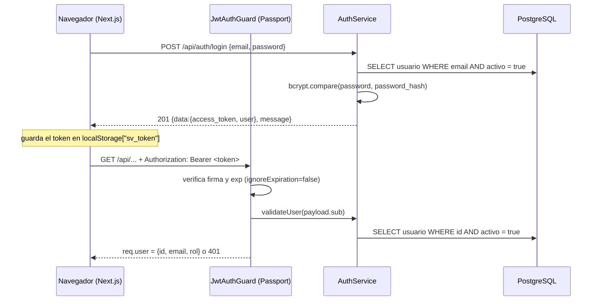

# 04 — Seguridad y acceso

> **Alcance:** autenticación, autorización, datos sensibles, carga de archivos, configuración secreta e invariantes de seguridad. **No cubre:** forma de los errores y paginación (→ `03-api-contract.md`), despliegue (→ `07-operacion.md`).
> **Fuentes:** `backend/src/auth/**`, `backend/src/main.ts`, `backend/src/app.module.ts`, `backend/src/documentos/*`, `backend/src/**/*.controller.ts`, `frontend/src/lib/api.ts`, `frontend/src/hooks/useAuth.ts`, `frontend/src/app/login/page.tsx`, `frontend/next.config.js`, `docker-compose*.yml`, `nginx/sello-verde.conf`.
> **Verificado contra:** commit `c66929e` (+ cambios locales sin commitear) · 2026-10-09
> **Lectores:** quien agregue endpoints (qué proteger y cómo), quien audite el sistema, agente de IA que toque auth/archivos.

> ⚠️ NO VERIFICADO (global): este documento se derivó de leer el código; no se ejecutó el sistema ni pruebas de penetración. Los hallazgos marcados "inferido" no se reprodujeron en ejecución, salvo el de `PUT` sin validación (BR-01), que sí se comprobó (ver allí).

## 1. Flujo de autenticación

**Prosa.** El login (`AuthService.login`) busca al usuario por `email` con `activo: true`, compara con `bcrypt` y emite un JWT con `JwtService.sign`. En cada request protegida, `JwtAuthGuard` (extiende `AuthGuard('jwt')`) delega en `JwtStrategy`, que extrae el token del header `Authorization: Bearer`, verifica firma y expiración y **vuelve a consultar la base** (`AuthService.validateUser`) para rechazar usuarios desactivados aunque su token siga vigente. `req.user` queda como `{ id, email, rol }`, tomando `rol` **del token**, no de la base (`jwt.strategy.ts:validate`).

| Aspecto | Valor real | Dónde |
|---|---|---|
| Emisión | `POST /api/auth/login` | `auth.controller.ts:login` |
| Claims | `sub` (id de usuario), `email`, `rol`, más `iat`/`exp` que añade la librería | `auth.service.ts:login` (payload) |
| Expiración | `24h` | `auth.module.ts` (`signOptions.expiresIn`) |
| Algoritmo | no configurado: usa el default de `@nestjs/jwt` | `auth.module.ts` |
| Secreto | `JWT_SECRET`, con valor por defecto embebido si falta | `auth.module.ts`, `jwt.strategy.ts` |
| Renovación / refresh / revocación | **No existen**; un token robado vale hasta `exp` (salvo desactivar al usuario) | — |
| Validación mínima de credenciales | `email` válido, `password` ≥ 4 caracteres | `auth/dto/login.dto.ts` |
| Mensaje de fallo de login | idéntico para usuario inexistente y clave incorrecta: `Credenciales inválidas` | `auth.service.ts:login` |
| Alta/baja de usuarios por API | **No existe**. El único usuario nace en `SeedService.initialSetup` | `database/seed/seed.service.ts` |
| Rate limiting / bloqueo por intentos | **No existe** (no hay Throttler) | búsqueda en `backend/src` |
| Cabeceras de seguridad (helmet) | No hay | `main.ts` |
| CORS | un único origen (`CORS_ORIGIN`, por defecto `http://localhost:3000`), `credentials: true` | `main.ts` |

**Lado cliente.** El frontend guarda el token en `localStorage` bajo la clave `sv_token` (`lib/constants.ts:TOKEN_KEY`, `lib/api.ts:getToken/setToken`), lo adjunta como `Bearer` en cada request y, ante un `401`, lo borra y redirige a `/login` (`lib/api.ts:request`). `api.upload` **no** aplica ese manejo de 401. La "protección de rutas" del frontend es solo de interfaz: `app/(protected)/layout.tsx` + `hooks/useAuth.ts` decodifican el payload con `atob` **sin verificar firma** y redirigen si no hay token; no existe `middleware.ts` de Next. La seguridad real está únicamente en el backend.

> 🔸 BRECHA [BR-06]: token JWT en `localStorage` (expuesto a cualquier XSS), 24 h de vida, sin refresh ni revocación. El plan histórico contemplaba un token en cookie `httpOnly` (`historico/implementation_plan_iter1.md`, "User Review Required"), que no se implementó.

> 🔸 BRECHA [BR-05]: `frontend/src/app/login/page.tsx` registra el token completo con `console.info('el token:', ...)` al iniciar sesión.

> ⚠️ NO VERIFICADO: en login, el camino de "usuario inexistente" no ejecuta `bcrypt.compare`, por lo que podría distinguirse por tiempo de respuesta. Medir para confirmar.

## 2. Modelo de roles y punto de aplicación

- **Existe un campo `rol`** en `usuarios` (varchar, default `'admin'`) y viaja en el token, pero **ningún código lo consulta**: no hay `@Roles`, `RolesGuard` ni comparaciones con `req.user.rol` (búsqueda en `backend/src`).
- El **único** control de acceso es `@UseGuards(JwtAuthGuard)` aplicado **a nivel de clase** en cada controller. No hay guard global (`APP_GUARD`).
- Implicancia para quien extiende el sistema: **un controller nuevo es público por defecto** salvo que declare `@UseGuards(JwtAuthGuard)`. Ver `05-guia-de-extension.md`.
- El diseño de negocio asume un único usuario (el encargado del SLEP): `flujo_software.md` abre diciendo que "el único usuario de la plataforma es el encargado del proceso".

> 🔸 BRECHA [BR-02]: no hay autorización por rol. Cualquier usuario autenticado y activo puede ejecutar todas las operaciones, incluido borrar establecimientos.

## 3. Matriz recurso × rol × operación

Como el único rol efectivo es "usuario autenticado" (cualquier valor de `rol`), la matriz se reduce a *público* vs *autenticado*. Verificado por búsqueda: todos los `*.controller.ts` contienen `JwtAuthGuard`; el único handler sin guard es `POST /auth/login`.

| Recurso | Leer | Crear | Modificar | Borrar | Quién |
|---|---|---|---|---|---|
| `auth/login` | — | `POST` | — | — | **Público** |
| `auth/me` | `GET` | — | — | — | Autenticado |
| Establecimientos | `GET` lista/detalle | `POST` | `PUT` | `DELETE` (soft + cascada) | Autenticado |
| Locales | `GET` (vía establecimiento) | `POST` | `PUT` | — | Autenticado |
| Instalaciones | `GET` | `POST` | `PUT` | `DELETE` (físico) | Autenticado |
| Expedientes | `GET` lista/detalle | `POST` | `PUT`, `PATCH estado-tc6`, `PATCH revert-tc6` | `DELETE` (ver BR-14) | Autenticado |
| Certificaciones | `GET` | `POST` | `PATCH` | — | Autenticado |
| Defectos | `GET` | `POST` (bulk) | (vía `PATCH` de la certificación) | (reemplazo vía `PATCH`) | Autenticado |
| Alertas | `GET` | (las crea el sistema) | `PATCH` estado | `DELETE` (solo `resuelta`) | Autenticado |
| Dashboard | `GET` | — | — | — | Autenticado |
| Documentos | `GET` lista, `GET descargar` | `POST` (subida) | `PATCH renombrar` | `DELETE` (físico + archivo) | Autenticado |
| `/uploads/**` (archivos estáticos) | `GET` | — | — | — | **Público** (BR-04) |

> 🔸 BRECHA [BR-04]: `ServeStaticModule` sirve `/uploads` sin autenticación (`app.module.ts`), y `frontend/next.config.js` lo reexpone en el dominio público (`/uploads/:path*`). Cualquiera que conozca o adivine una ruta de archivo podría descargarla sin token, saltándose la protección de `GET /documentos/:id/descargar`. ⚠️ NO VERIFICADO: el `rootPath` se calcula como `join(__dirname, '..', '..', 'uploads')` desde `dist/`, que apunta **fuera** de `backend/` (p. ej. `/uploads` en el contenedor), mientras que Multer escribe en `uploads/` relativo al directorio de trabajo (`/app/uploads`). Es posible que hoy el estático no resuelva los archivos reales; confirmar en ejecución antes de afirmar la exposición.

## 4. Invariantes de seguridad

**No existe ninguna suite de tests** en el repo (no hay archivos `*.spec.ts`/`*.test.*` ni carpeta `test/`), de modo que **ningún invariante tiene un test que se rompa si se viola**. La columna "Test" es siempre *ninguno*. Los invariantes se derivan del código y deben protegerse con tests al implementarse la infraestructura de pruebas (BR-17).

| ID | Invariante | Cómo se garantiza hoy | Si se viola | Test |
|---|---|---|---|---|
| INV-S1 | Todo endpoint salvo `login` exige token válido | `@UseGuards(JwtAuthGuard)` por clase en cada controller | Un controller nuevo sin guard queda público | ninguno |
| INV-S2 | `password_hash` nunca sale en una respuesta | `AuthService.login/getMe` proyectan campos a mano; ninguna otra entidad se relaciona con `Usuario` | Devolver la entidad `Usuario` completa filtra el hash | ninguno |
| INV-S3 | Un token vencido se rechaza | `ignoreExpiration: false` en `JwtStrategy` | Tokens eternos | ninguno |
| INV-S4 | Un usuario desactivado no entra, ni siquiera con token vigente | `login` filtra `activo: true` y `JwtStrategy.validate` revalida contra BD | Usuarios dados de baja conservan acceso hasta `exp` | ninguno |
| INV-S5 | El login no revela si el correo existe | Mismo mensaje en ambos fallos (`auth.service.ts:login`) | Enumeración de usuarios | ninguno |
| INV-S6 | La descarga de documentos exige token | `GET /documentos/:id/descargar` está tras `JwtAuthGuard` | Documentos descargables sin sesión | ninguno (y ver BR-04) |
| INV-S7 | Subida limitada a 50 MB | `limits.fileSize` en `documentos.controller.ts`; `client_max_body_size 55m` en `nginx/sello-verde.conf` | Agotamiento de disco/memoria | ninguno |

Invariantes de **datos sensibles** (qué campos no deben filtrarse) hoy **solo se cumplen para `password_hash`** (INV-S2). Los demás datos sensibles de `02-modelo-datos.md` §7 se devuelven completos: no existe proyección ni test de no-filtración.

## 5. Validación de entrada y mass assignment

`main.ts` instala un `ValidationPipe` global con `whitelist: true`, `forbidNonWhitelisted: false`, `transform: true`: las propiedades no declaradas en un DTO **se descartan en silencio** (no se rechazan).

> 🔸 BRECHA [BR-01]: los `PUT` de `establecimientos/:id`, `locales/:id`, `instalaciones/:id` y `expedientes/:id` declaran el cuerpo como `Partial<CreateXDto>`. Ese tipo genérico se compila a `Object`, por lo que el `ValidationPipe` **no valida ni filtra** el cuerpo, y el servicio hace `Object.assign(entidad, dto)` antes de `save()`. Un cliente autenticado puede escribir cualquier columna (p. ej. `estado_general`, `deleted_at`, `rbd`, incluso `id`). **Comprobado:** en el `dist/` compilado el parámetro de `PUT /establecimientos/:id` tiene metadata `[Number, Object]`, y ejecutar el `ValidationPipe` de esta configuración sobre un cuerpo con `metatype: Object` devuelve el cuerpo intacto. (`dist/` puede estar desactualizado respecto a `src`, pero el patrón `Partial<...>` es el mismo en el código fuente actual.) `PATCH /certificaciones/:id` no tiene el problema porque usa una clase real (`UpdateCertificacionDto`).

## 6. Carga y servicio de archivos

Fuente: `documentos/documentos.controller.ts`, `documentos.service.ts`.

- Destino: `uploads/expedientes/<expedienteId>/<nombre sanitizado>`. El nombre se sanea quitando espacios y caracteres fuera de `[a-zA-Z0-9._\-áéíóúÁÉÍÓÚñÑ]`.
- El nombre en disco **es el nombre original saneado**: dos subidas con el mismo nombre en el mismo expediente se sobrescriben (a propósito: el servicio detecta `nombre_original` repetido y reemplaza archivo y fila; mensaje "Documento sobreescrito exitosamente"). Dos nombres distintos que se sanean al mismo valor también colisionan en disco sin aviso.
- No se valida tipo MIME ni extensión; se guarda lo que declare el cliente (`tipo_mime = file.mimetype`).
- El `DELETE` borra fila y archivo (físicos, sin papelera).

> 🔸 BRECHA [BR-07]: el `destination` de Multer usa `req.params.expedienteId` **crudo**, y el interceptor de Multer se ejecuta **antes** que `ParseIntPipe` (orden de Nest: guards → interceptors → pipes). Un valor no numérico podría crear/escribir fuera de `uploads/expedientes/`. ⚠️ NO VERIFICADO: requiere probar con parámetros codificados (`%2e%2e`, `%2f`). Además no se valida que el archivo exista en la petición (`file` indefinido) y no hay filtro de tipos.

## 7. Secretos y configuración sensible

Variables sensibles: `JWT_SECRET`, `DATABASE_PASSWORD`/`DB_PASSWORD`, `ADMIN_PASSWORD` (significado y uso en `07-operacion.md`). **Nunca valores en la documentación.**

> 🔸 BRECHA [BR-03]: hay valores por defecto embebidos para secretos en código y en el compose de desarrollo: fallback de `JWT_SECRET` en `auth.module.ts` y `jwt.strategy.ts`, fallback de contraseña de BD en `app.module.ts`, fallback de contraseña/correo de admin en `seed.service.ts`, y defaults de `DB_PASSWORD`/`JWT_SECRET` en `docker-compose.yml`. Si una variable falta en un entorno, el sistema arranca igualmente con un secreto público (está en el repositorio). `docker-compose.prod.yml` no define defaults (usa `${VAR}` sin fallback), pero el código sí los tiene.

`.env`, `.env.production` y `backend/.env` están en `.gitignore` (`.env`, `.env.production`); solo `frontend/.env.example` está versionado.

## 8. Otros puntos de exposición

- `GET /api` no tiene handler (Nest respondería 404; no se ejecutó); los healthchecks de Docker lo usan esperando "código < 500" (`docker-compose.prod.yml`, `backend/Dockerfile.prod`), así que el healthcheck solo prueba que el proceso HTTP responde, no la base de datos.
- `docker-compose.prod.yml` publica `3001:3001` del backend en **todas** las interfaces del host, contradiciendo su propio comentario de cabecera ("db y backend NUNCA exponen puertos al host"). El frontend sí se limita a `127.0.0.1:3080`.
  > 🔸 BRECHA [BR-20]: puerto del backend expuesto en producción pese a la intención documentada en el compose.
- El frontend muestra datos ficticios de dashboard cuando la API falla (`hooks/useDashboard.ts`, bloque `catch`): un error de backend se ve como cifras plausibles.
  > 🔸 BRECHA [BR-23]: `useDashboard` sustituye errores por cifras mock en vez de mostrar el error.
